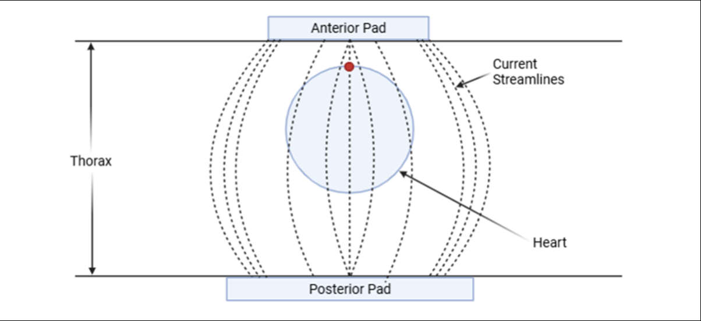
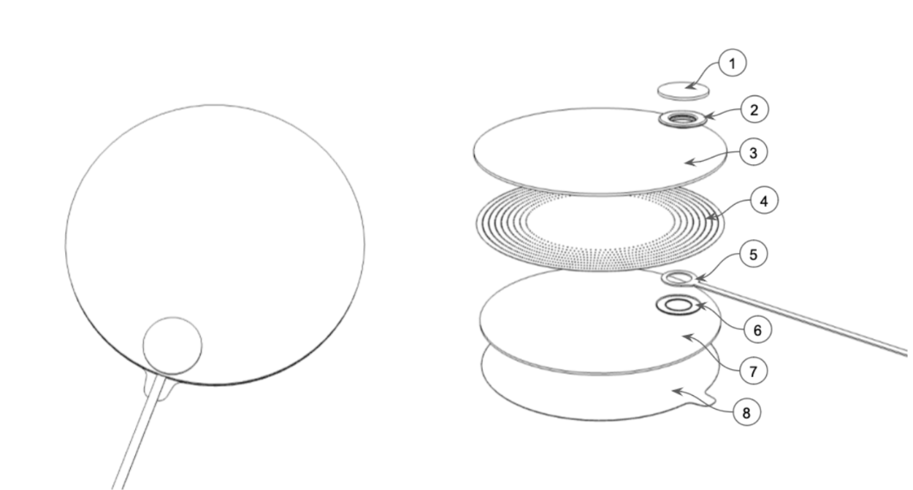
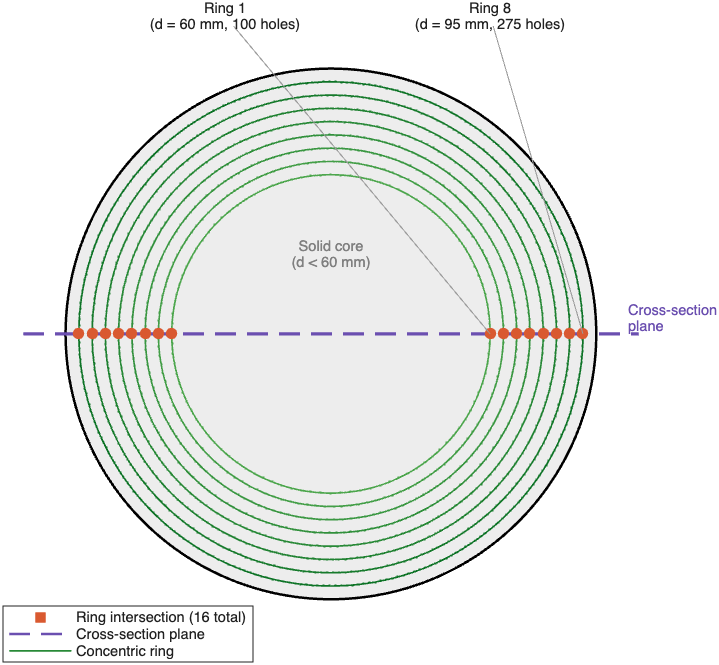
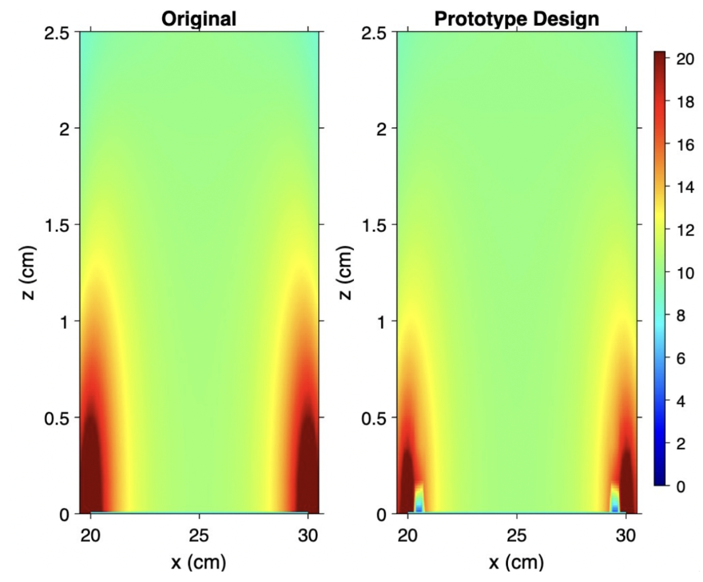
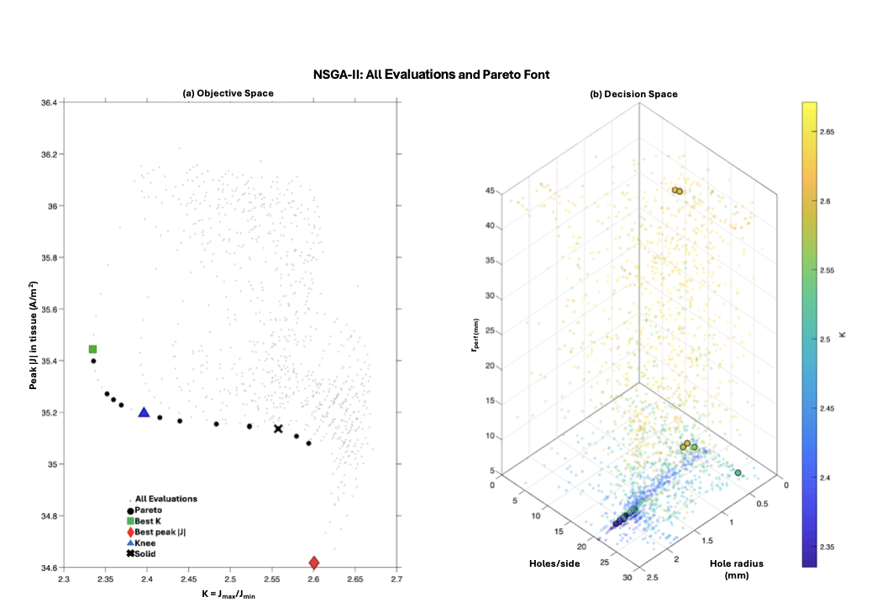

# External Pacing Pads - Perforated Ag/AgCl Electrode + FEM + NSGA-II

A redesigned transcutaneous pacing pad that spreads current more evenly across the skin to cut pain and burn risk. The anterior pad uses a perforated Ag/AgCl layer on Mylar: 1,500 × 0.4 mm holes in eight concentric rings push current away from the pad edge, where hotspots form. A larger posterior pad completes the anterior–posterior configuration. The hole geometry was chosen with a 2D finite-element thorax model and NSGA-II multi-objective optimisation in MATLAB.

Built as a group design project (Group 4967, 2025–26) by seven Bioengineering students at Imperial College London, supervised by Dr Nick Linton.

> ❗️**Research prototype, not a medical device.** Results are from simulation only. The pad has not been bench- or clinically tested and must not be used on people.



---

## Features
- **Impedance-gradient electrode.** Perforations raise impedance toward the pad periphery, redistributing current away from the edge where burns start.
- **2D finite-element thorax model** (MATLAB PDE Toolbox) solving the generalised Laplace equation on a sagittal slice with a cardiac inclusion.
- **NSGA-II optimisation** over hole radius, hole count and perforation start radius. About 2,400 designs are evaluated to map the Pareto front between uniformity and peak current density.
- **Parameter sensitivity** across every evaluated design, showing which geometric levers actually matter.
- **Manufacturable ring layout.** Eight concentric rings (100 → 275 holes) at the CO₂ laser cutter's 0.4 mm minimum feature size, with a hole-diameter sweep to check robustness.
- **Asymmetric pad sizing.** A back-pad width sweep (60–240 mm) with the front pad fixed at 100 mm.
- **Fabrication workflow.** Fusion 360 → DXF → laser-cut Mylar substrate, with an Ag/AgCl coating and PEDOT:PSS hydrogel stack ready for assembly.

---

## Pad Design
- 100 mm circular anterior pad with a perforated conductive layer
- 140 mm circular posterior pad
- 0.125 mm Mylar film substrate (RS Components 7850798)
- Ag/AgCl paste, 60:40 (Sigma-Aldrich 901773)
- PEDOT:PSS composite hydrogel skin interface
- High-density white foam insulating plate
- Brass eyelet, brass/copper ring terminal wire and brass washer

Full layer stack and perforation spec: [`design/README.md`](design/README.md).



### Perforation Pattern
Eight concentric rings of 0.4 mm holes from 60 mm to 95 mm diameter, in 5 mm steps. Each ring adds 25 holes, so there are 1,500 in total. The centre (< 60 mm) stays solid to give the coating and hydrogel reliable contact.



> Only the laser-cut Mylar was made. The Ag/AgCl paste and hydrogel arrived too late to coat and assemble the pad before the deadline.

---

## Model Parameters

| Region | Property | Value |
|---|---|---|
| Domain | Size (sagittal slice) | **0.50 × 0.25 m** |
| Bulk tissue | Conductivity σ | **0.2 S/m** |
| Heart | Radius / depth / σ | **45 mm** / **95 mm** / **0.5 S/m** |
| Electrodes | Width / thickness | **100 mm** / **1 mm** |
| Ag/AgCl layer | σ (from ρ = 5 Ω, d = 1 mm) | **0.2 S/m** |
| Perforations | σ (insulating) | **10⁻⁸ S/m** |
| Boundaries | Active / ground / elsewhere | **10 V** / **0 V** / Neumann (dV/dn = 0) |

> Note: the back-pad sweep uses its own parameter set (tissue 0.3 S/m, heart 0.7 S/m, heart radius 90 mm, 5 V drive). See [`simulation/README.md`](simulation/README.md#known-issues).

---

## Software Requirements
MATLAB R2020b or later with:

- **Partial Differential Equation Toolbox** (`createpde`, `solvepde`, `decsg`)
- **Global Optimization Toolbox** (`gamultiobj`)
- **Statistics and Machine Learning Toolbox** (`prctile`)

For the pad geometry:
- **Autodesk Fusion 360** to edit the perforation sketch and export the DXF.

---

## Installation
1. **Clone the repository**
   ```bash
   git clone https://github.com/your-username/external-pacing-pads.git
   cd external-pacing-pads
   ```
2. Open MATLAB and set the working folder to `simulation/`.
3. Check the toolboxes are installed:
   ```matlab
   ver
   ```
4. Run a script from the Command Window (see [Usage](#usage)).

---

## Configuration

Edit `defaultParameters()` in `perforatedElectrodeNSGA2.m`. All lengths are in **metres**:

```matlab
p.domainWidth  = 0.50;   p.domainHeight = 0.25;
p.heartRadius  = 0.045;  p.heartZ = 0.095;
p.sigma_tissue = 0.2;    p.sigma_heart  = 0.5;   % S/m
p.Vapp         = 10;     % V, active electrode
p.padWidth     = 0.10;   % front and back pad width
p.rho_metal    = 5;      % Ag/AgCl surface resistivity
p.sigma_hole   = 1e-8;   % perforation (insulating)
```

Optimisation bounds and settings:
```matlab
lb = [0.0002,  2, 0.005];   % hole radius [m], holes/side, r_perf [m]
ub = [0.0025, 30, 0.045];
popSize = 60;  maxGen = 40; % ~2,400 evaluations
```

Mesh resolution:
- **Optimisation (coarse):** `Hmax = 2.0 mm`, `Hmin = 0.5 mm`
- **Final re-solve (fine):** `Hmax = 1.2 mm`, `Hmin = 0.3 mm`

---

## How It Works

1. **Geometry**  
   `buildGeometry()` builds a rectangle (thorax) plus a circle (heart) with `decsg`. The top and bottom edges are split at the pad boundaries so each electrode gets its own boundary condition.

2. **Perforations**  
   Holes aren't meshed explicitly. `condCoeff()` checks each mesh evaluation point and assigns σ = 10⁻⁸ S/m if it falls inside a hole, or the Ag/AgCl value otherwise.

3. **Solve**  
   `solvepde()` solves −∇·(σ∇V) = 0. Current density is then |J| = |−σ∇V| at every node, interpolated onto a regular grid.

4. **Metrics**  
   - **Non-uniformity:** K = J<sub>max</sub>/J<sub>min</sub> along a line 0.5 mm below the electrode–tissue interface. K = 1 is perfectly uniform.  
   - **Peak |J|:** maximum current density in bulk tissue, excluding the heart and the electrode layers.

5. **Optimisation**  
   `gamultiobj` minimises K and peak |J| together. Three Pareto designs are kept: best K, best peak |J|, and the knee point (closest to the origin in normalised objective space). These are re-solved on the fine mesh.

6. **Ring Design**  
   `ringElectrodeSimulation.m` takes the manufacturable eight-ring layout. The cross-section plane crosses each ring twice, giving 16 holes, and the hole diameter is swept from 0.1 to 2.0 mm.

---

## Usage

1. Run the optimisation. This is slow (about 2,400 FEM solves):
   ```matlab
   perforatedElectrodeNSGA2
   ```
2. Run the hole-diameter sweep on the ring design:
   ```matlab
   ringElectrodeSimulation
   ```
3. (Optional) Run the back-pad sweep once its helper functions are added:
   ```matlab
   sweepBackPadLength_only
   ```
4. Figures open automatically, and each script saves a `.mat` file to the working folder.

---

## Data Output

### Command Window (NSGA-II)
```
PARETO FRONT:
 #    r(mm)    n/s    r_perf(mm) | K        peakJ
 ...
 Best K    : K=2.33 peakJ=35.44 (r=2.12mm n=21 rp=5.5mm)
 Knee      : K=2.40 peakJ=35.19 (r=2.00mm n=21 rp=5.7mm)
 Best peakJ: K=2.60 peakJ=34.62 (r=0.77mm n=18 rp=44.2mm)
```

### Saved Files
| File | Contents |
|---|---|
| `nsga2_perforated_results.mat` | Pareto set, all valid evaluations, key-solution indices, solid baseline (coarse + fine) |
| `ring_electrode_results.mat` | Per-diameter K, peak \|J\|, fields and line profiles, solid baseline |

### Figures
| Script | Figures |
|---|---|
| `perforatedElectrodeNSGA2` | Pareto front, decision space, \|J\| maps (full + zoomed), line profiles, parameter sensitivity |
| `ringElectrodeSimulation` | Line profiles per diameter, K and peak \|J\| vs diameter, \|J\| maps, % change from solid |
| `sweepBackPadLength_only` | Edge hotspot, heart-wall \|J\|, total current, effective resistance and K vs back-pad width |

---

## Results



- **Edge hotspots:** the solid pad shows clear hotspots at both edges. The perforated design reduces them.
- **Pareto front:** no perforated design beat the solid pad on both objectives at once. The best-uniformity design cut K by **9.0%** (2.56 → 2.33), but peak |J| rose 0.9%. The knee point cut K by **6.3%** with peak |J| essentially unchanged.
- **Main lever:** the perforation start radius. Every Pareto-optimal design had r<sub>perf</sub> < 10 mm. Above 30 mm, perforations gave no improvement over solid.
- **Ring design (0.4 mm holes):** K fell from 2.82 to 2.76 (**−2.3%**). Keep hole diameter below about half the ring spacing. At 2.0 mm, K rose by 16.9%.
- **Back pad:** K reached a minimum of **6.08 at 140 mm**. Heart-wall current density kept rising with width but levelled off above 160 mm.



Full results: [`docs/results.md`](docs/results.md).

---

## Troubleshooting

- **`Undefined function 'createpde'` or `'gamultiobj'`**
  - A toolbox is missing. Run `ver` and install the PDE, Global Optimization and Statistics toolboxes.

- **`Undefined function 'buildThoraxModelWithInterface'`**
  - The back-pad sweep's helper functions weren't in the report appendix. Add them to `simulation/` before running it.

- **The optimisation takes too long**
  - Lower `popSize` or `maxGen` for a quick run.
  - Set `'UseParallel', true` in `optimoptions` if you have the Parallel Computing Toolbox.

- **K comes out as NaN, or evaluations return [100, 100]**
  - The evaluation line hit NaNs from `griddata`, or the solve failed. Check that the mesh is fine enough near the pad, and that `rPerf` leaves at least 2 mm of perforated region.

- **Holes overlap or disappear in the ring sweep**
  - Above 2.5 mm diameter, holes cover the whole 2.5 mm ring gap. The script warns above 1.25 mm radius.

---

## Notes & Limitations
- **2D only.** The sagittal slice captures radial redistribution but not how holes are spread around each ring. A full 3D model is needed for that.
- **Homogeneous tissue.** Skin, fat, muscle and bone aren't separated. This is fine for ranking designs, not for absolute in-vivo values.
- **Baselines differ between scripts.** Mesh resolution differs, so the solid K is 2.56 in the optimisation and 2.82 in the ring sweep. Compare designs within a script, not across them.
- **The ring design isn't the optimum.** Optimisation favoured larger holes (2.0–2.5 mm radius) starting near the centre. The built design uses 0.4 mm holes and a solid core for manufacturability.
- **Laser cutting may distort small holes** through local melting of the Mylar. Manual paste coating can also vary in thickness.
- **No experimental validation yet.** The phantom protocol is written but wasn't run. See [`docs/bench-validation.md`](docs/bench-validation.md).
- **The code was recovered from the report appendix** and hasn't been re-run since.

More detail: [`simulation/README.md`](simulation/README.md#known-issues).

---

## Project Structure

```
external-pacing-pads/
├── simulation/
│   ├── perforatedElectrodeNSGA2.m     # FEM model + NSGA-II perforation optimisation
│   ├── ringElectrodeSimulation.m      # Eight-ring design, hole-diameter sweep
│   ├── sweepBackPadLength_only.m      # Posterior pad width sweep
│   └── README.md                      # Model, parameters, known issues
├── design/
│   └── README.md                      # Layer stack, perforation spec, fabrication
├── docs/
│   ├── images/                        # Figures
│   ├── results.md                     # Optimisation, ring sweep, back-pad sweep
│   ├── bench-validation.md            # Planned phantom test protocol
│   └── final-report.pdf               # Full project report
└── README.md
```

---

## Team
Vinayak Gupta · Michelle Liao · **Sean Obi** · Vivian Sullyunna · Rohan Turner · Jaehoon Yi · Richard Zhao

---

## Acknowledgements
- Dr Nick Linton (supervisor)
- Krasteva & Papazov: *Estimation of current density distribution under electrodes for external defibrillation* (BioMedical Engineering OnLine, 2002), the basis of the FEM approach
- Deb, Pratap, Agarwal & Meyarivan: *A fast and elitist multiobjective genetic algorithm: NSGA-II* (IEEE Trans. Evol. Comput., 2002)
- Meyer et al.: *Impedance-gradient electrode reduces skin irritation induced by transthoracic defibrillation* (Med. Biol. Eng. Comput., 2005)
- DeMonte et al.: *Measurement of edge effects in automatic external defibrillation electrodes using current density imaging* (ISMRM, 2005), the basis of the phantom protocol
- MATLAB PDE Toolbox · Autodesk Fusion 360 · Universal Laser Systems VLS2.30 · BioRender
