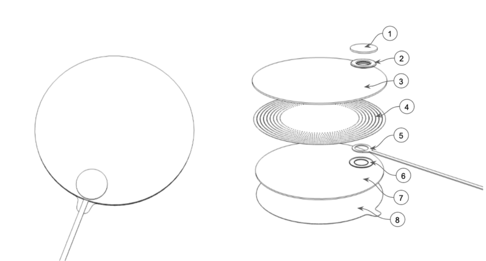
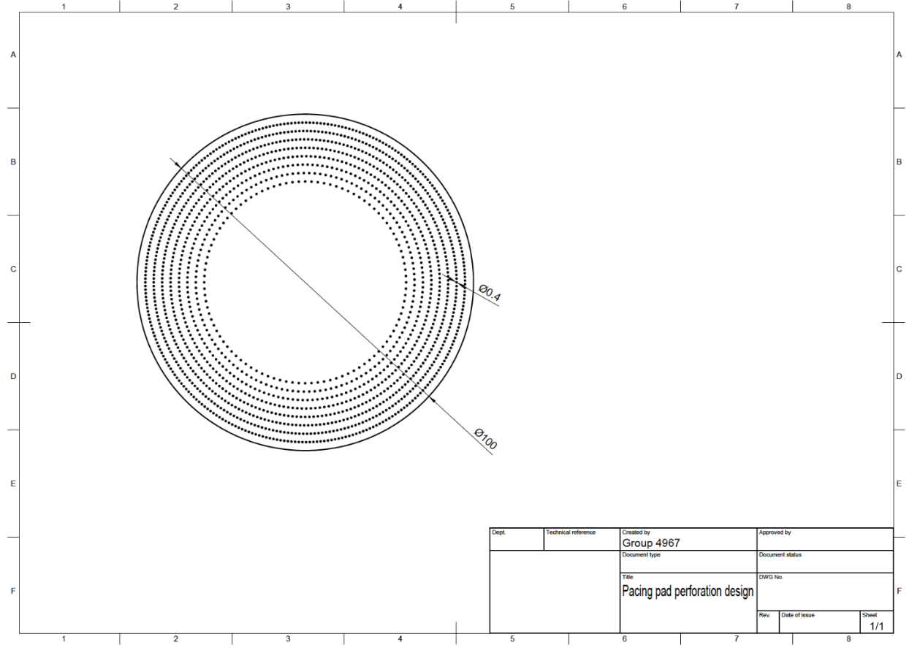

# Pad Design

The anterior pad is a multilayer electrode with a perforated Ag/AgCl conductive layer. The perforations reduce conductive area toward the edge, which raises edge impedance and pushes current back toward the centre.

---

## Layer Stack

| # | Layer | Material | Role |
|---|---|---|---|
| 1 | Insulating plate | High-density white foam | Non-conductive structural support |
| 2 | Eyelet | Brass | Electrical connection through the stack |
| 3 | Backing | — | Mechanical support |
| 4 | Conductive layer | Ag/AgCl on 0.125 mm Mylar, perforated | Impedance gradient |
| 5 | Ring terminal wire | Brass/copper | Lead to the pacing unit |
| 6 | Washer | Brass | Secures and reinforces the terminal |
| 7 | Hydrogel | PEDOT:PSS composite | Electrode–skin interface |
| 8 | Release film | — | Removed just before use |

---

## Perforation Spec

| Ring | Diameter (cm) | Radius (mm) | Holes |
|---|---|---|---|
| 1 | 6.0 | 30.0 | 100 |
| 2 | 6.5 | 32.5 | 125 |
| 3 | 7.0 | 35.0 | 150 |
| 4 | 7.5 | 37.5 | 175 |
| 5 | 8.0 | 40.0 | 200 |
| 6 | 8.5 | 42.5 | 225 |
| 7 | 9.0 | 45.0 | 250 |
| 8 | 9.5 | 47.5 | 275 |

- **Hole diameter:** 0.4 mm (the laser cutter's minimum feature size)
- **Total holes:** 1,500
- **Pad diameter:** 100 mm front, 140 mm back
- **Solid core:** < 60 mm diameter

> The 0.4 mm holes and 30 mm solid core are a manufacturing compromise. Optimisation favoured larger holes starting much closer to the centre. See [`../docs/results.md`](../docs/results.md).

---

## Fabrication

1. Draw the perforation pattern in **Fusion 360** and export it as a DXF.
2. Laser-cut and perforate the Mylar on a **Universal Laser Systems VLS2.30** CO₂ cutter.
3. Spread the Ag/AgCl paste (60:40, Sigma-Aldrich 901773) over the Mylar with a plastic palette knife.
4. Dry at **80 °C for 10 min** to drive off the solvent.
5. Assemble the stack with the eyelet, terminal wire and washer, then apply the hydrogel and release film.

**Status:** steps 1–2 are done. Steps 3–5 are waiting on materials.

---

## Materials

| Part | Source |
|---|---|
| Mylar film, 0.125 mm | RS Components 7850798 |
| Ag/AgCl paste, 60:40 | Sigma-Aldrich 901773 |
| PEDOT:PSS hydrogel | Prepared in-lab (24 h gelation) |
| Control pads | Mindray radiolucent electrodes |

> PEDOT:PSS conducts well but doesn't stick well to skin, which can raise interface impedance. Blending it with PDMAPS (a zwitterionic polymer) is the next thing to try.
