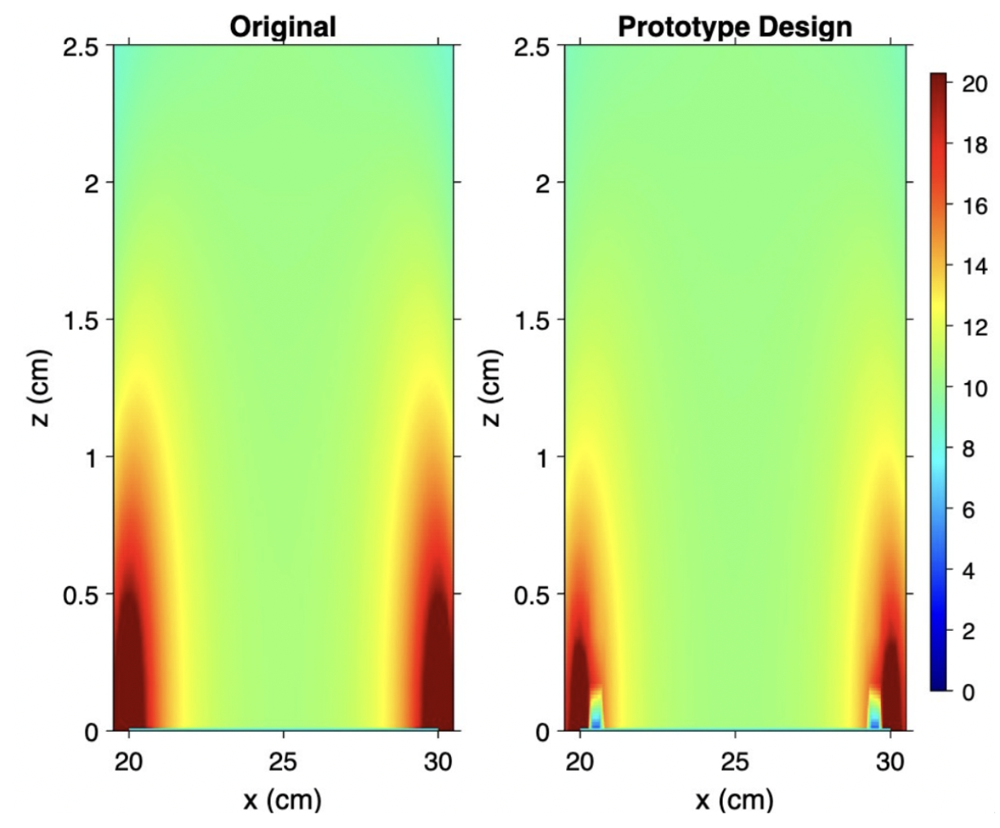
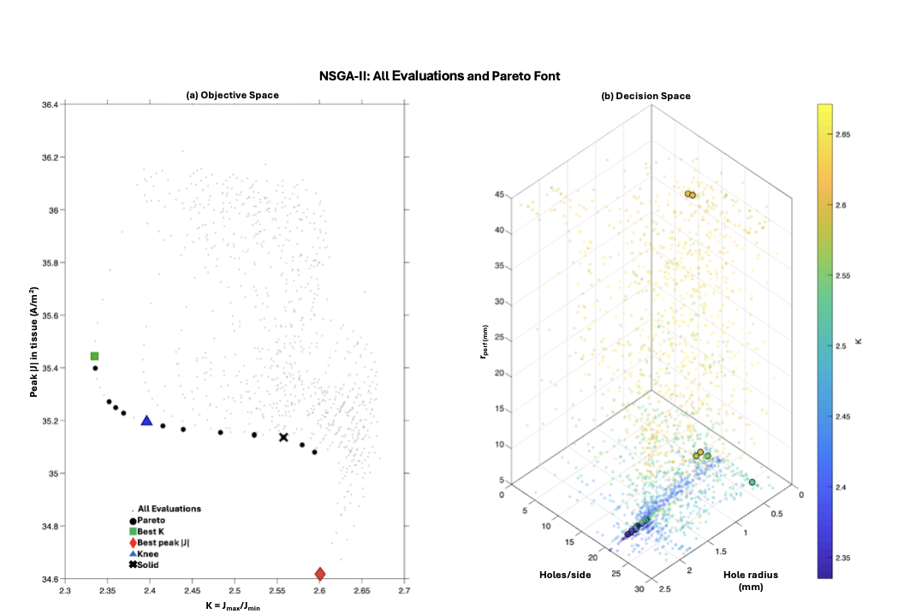
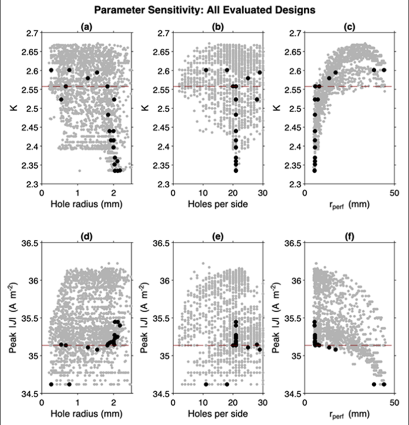
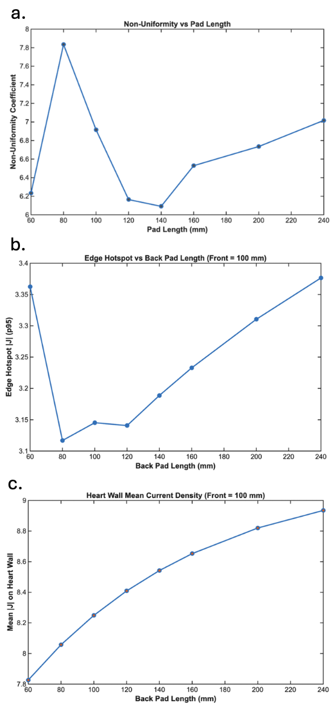

# Results

All results are from the 2D finite-element model. None have been checked experimentally yet.

---

## Baseline

The solid pad shows pronounced current-density hotspots at both edges, where current streamlines converge. The perforated design reduces them. Small low-|J| pockets appear at each hole, which confirms the holes redirect current.

---

## NSGA-II Optimisation

1. Evaluate about 2,400 designs (population 60, 40 generations) on the coarse mesh.
2. Keep the non-dominated set as the Pareto front.
3. Pick three designs: best K, best peak |J| and the knee point.
4. Re-solve them on the fine mesh.

| Design | Hole radius (mm) | Holes/side | rperf (mm) | K | Peak \|J\| (A/m²) | ΔK |
|---|---|---|---|---|---|---|
| Solid baseline | — | 0 | — | 2.56 | 35.14 | — |
| Best uniformity | 2.12 | 21 | 5.5 | 2.33 | 35.44 | −9.0% |
| Knee point | 2.00 | 21 | 5.7 | 2.40 | 35.19 | −6.3% |
| Best peak \|J\| | 0.77 | 18 | 44.2 | 2.60 | 34.62 | +1.6% |

**Result:** No perforated design improved both objectives at once, so the solid pad sits on the Pareto front itself. The front spans K ≈ 2.33–2.60 and peak |J| ≈ 34.6–35.4 A/m². The trade-off comes from current crowding at the edges of the holes.

---

## Parameter Sensitivity

| Variable | Effect |
|---|---|
| rperf | **Strongest.** Every Pareto design had rperf < 10 mm. Above 30 mm, no design beat the solid pad |
| Hole radius | Threshold near 1.5 mm. K barely moves below it and falls steeply above it, but peak \|J\| spreads out |
| Holes per side | **Weakest.** The optimiser settled on 18–21 |

**Result:** Redistribution needs perforations across a large share of the pad, not just a ring at the edge.

---

## Ring Design: Hole Diameter

The eight-ring layout was simulated with 16 holes in the cross-section (two per ring) on the fine mesh.

| dhole (mm) | K | Peak \|J\| (A/m²) | ΔK | Δpeak \|J\| |
|---|---|---|---|---|
| Solid | 2.82 | 36.84 | — | — |
| 0.1 | 2.82 | 36.85 | < 0.1% | < 0.1% |
| 0.2 | 2.75 | 36.79 | −2.5% | −0.1% |
| 0.3 | 2.75 | 36.80 | −2.6% | −0.1% |
| **0.4** | **2.76** | **36.88** | **−2.3%** | **+0.1%** |
| 0.6 | 2.77 | 36.95 | −2.0% | +0.3% |
| 0.8 | 2.78 | 37.08 | −1.5% | +0.6% |
| 1.0 | 2.80 | 37.25 | −0.9% | +1.1% |
| 1.5 | 2.66 | 37.31 | −5.8% | +1.3% |
| 2.0 | 3.30 | 38.74 | +16.9% | +5.1% |

**Result:** The chosen 0.4 mm holes give ΔK = −2.3% and hold up to ±0.1 mm error. There are three regimes:

- below 0.6 mm, small gains with no peak penalty,
- 0.8–1.0 mm, where crowding starts to cancel the gain, and
- 2.0 mm, where each hole fills 80% of the 2.5 mm gap and performance collapses.

The 1.5 mm dip is likely a resonance between hole width and ring spacing. The design rule is to keep hole diameter below about half the ring spacing.

---

## Back Pad Width

The front pad was fixed at 100 mm and the back pad swept from 60 to 240 mm.

| Metric | Trend | Best |
|---|---|---|
| K | Peaks at 80 mm (7.83), then falls | **6.08 at 140 mm** |
| Edge hotspot (p95 \|J\|) | Shallow U-shape | 3.12 A/m² at 80 mm |
| Heart-wall mean \|J\| | Rises monotonically, levels off above 160 mm | 8.94 A/m² at 240 mm |

**Result:** No single width optimises all three metrics. 140 mm was chosen for its K minimum, with only a modest loss in heart-wall current density.

> These K values come from a continuous impedance model with its own parameters. Don't compare them with the tables above.

---

## Comparison with Krasteva & Papazov (2002)

Their millimetre-scale slots reduced K by 71%. This project got 9.0% (optimised) and 2.3% (manufactured). The gap is mainly the 0.4 mm minimum feature size. Both studies agree that insulating regions shift current away from the periphery.
